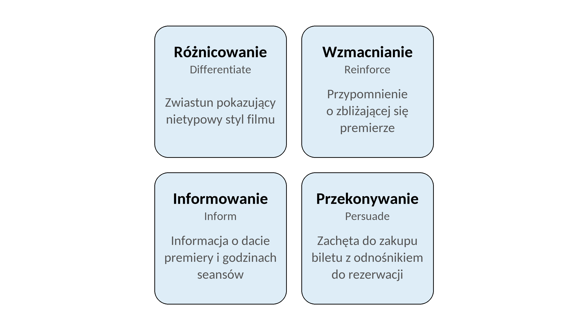
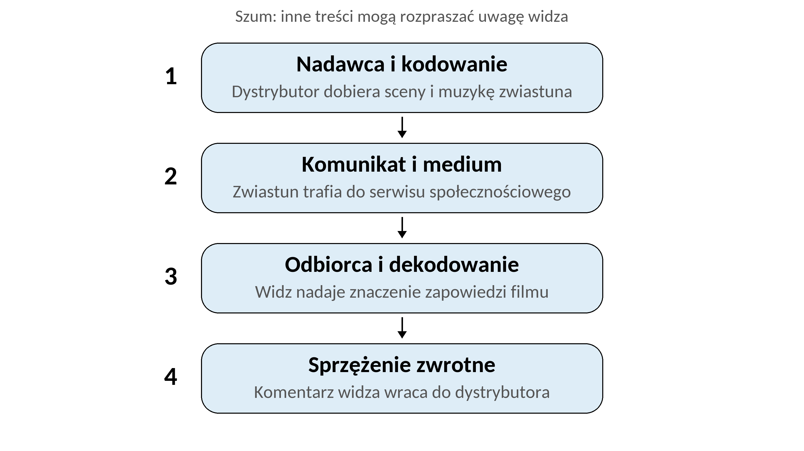

# Rozdział 1. Teoretyczne podstawy marketingu kinowego

**1.1. Istota i specyfika komunikacji marketingowej w branży kinowej**

Widz rozważający obejrzenie filmu po raz pierwszy podejmuje decyzję przed poznaniem całego utworu. Może zapoznać się ze zwiastunem, recenzjami i opiniami innych osób, ale to dopiero po seansie będzie mógł ocenić doświadczenie. Komunikacja marketingowa pomaga mu zatem rozpoznać ofertę i sformułować oczekiwania. Po stronie branży odrębnym problemem jest niepewność wyniku komercyjnego. Wysokie ryzyko i niepewność powodzenia filmu są trwałymi cechami działalności filmowej.[^kerrigan-ryzyko] Więc trudność oceny przyszłego doświadczenia generuje problemy zarówno dla widza, jak i dla uczestników rynku, próbujących oszacować przychody.

Marketing obejmuje rozpoznawanie potrzeb odbiorców oraz przygotowanie oferty, która ma dla nich wartość. Kotler, Keller i Chernev wiążą zaspokajanie potrzeb ludzkich i społecznych z realizacją celów organizacji. Do działań marketingowych zaliczają tworzenie oferty, jej komunikowanie i dostarczanie oraz wymianę. Przedmiotem tych działań mogą być dobra materialne, usługi i doświadczenia.[^kotler-podstawy] Komunikacja jest więc częścią marketingu, wyjaśniającą, co organizacja oferuje, komu i na jakich warunkach.

W niniejszej pracy przyjmuje się definicję komunikacji marketingowej Filla i Turnbull. Autorzy ujmują ją jako działania służące angażowaniu odbiorców i inicjowaniu rozmów z nimi oraz między nimi, które przez odpowiednio przygotowane przekazy mają wywoływać określone reakcje dotyczące postaw, emocji lub zachowań. Punktem wyjścia jest rozpoznanie potrzeb i sytuacji publiczności, a dobór form komunikacji może obejmować przekaz jednokierunkowy, komunikację dwukierunkową, interakcję i dialog.[^fill-definicja]

Przyjęcie tej definicji pozwala objąć analizą zarówno przekazy dystrybutorów i kin, jak i rozmowy widzów o filmach oraz wymianę opinii o seansach. W tym zakresie rozróżnia się oficjalne przekazy podmiotów branży i treści tworzone przez użytkowników. Rozróżnienie nadawców pozwala porównywać odbiór ich komunikatów, w tym ocenę autentyczności. Komunikacja marketingowa może prowadzić do zmian w postawach, emocjach i zachowaniach odbiorców.

Komunikację marketingową można rozpatrywać z dwóch perspektyw. Model DRIP porządkuje jej zadania, czyli wyjaśnia, do czego służą przekazy. Model procesu komunikacji pokazuje natomiast, jak przekaz powstaje, dociera do odbiorcy i jak odbiorca może na niego odpowiedzieć. Oba ujęcia uzupełniają się i zostaną przedstawione na przykładzie promocji filmu.

Fill i Turnbull wyróżniają cztery zadania komunikacji, określane skrótem DRIP: różnicowanie (*differentiate*), wzmacnianie (*reinforce*), informowanie (*inform*) i przekonywanie (*persuade*). Różnicowanie pozwala wyróżnić ofertę na tle konkurencji. Wzmacnianie podtrzymuje wcześniejsze przekazy i doświadczenia. Informowanie dostarcza wiedzy o cechach oferty i jej dostępności, co może zmniejszać postrzegane ryzyko zakupu. Przekonywanie zachęca do dalszego działania, w tym do zakupu. Autorzy wiążą dobór tych zadań z sytuacją odbiorcy i wskazują, że w danej kampanii można koncentrować się na jednym lub dwóch z nich.[^fill-zadania]

Na potrzeby tej pracy zadania DRIP odniesiono do promocji filmu. Rysunek 1 przedstawia własne przykłady ich zastosowania w komunikacji kinowej. Ten sam materiał, na przykład zwiastun zawierający datę premiery i zachętę do zakupu biletu, może zarówno informować, jak i przekonywać.

\figurestart

{width=15.5cm}

\figuretitle{Rysunek 1. Przykłady zastosowania zadań DRIP w komunikacji kinowej}

\figuresource{Źródło: opracowanie własne na podstawie Fill i Turnbull (2023, s. 10-12). Przykłady dotyczące kina stanowią własną ilustrację modelu}

\figureend

Zadania DRIP nie wyznaczają obowiązkowej kolejności reakcji publiczności. Współczesny proces zakupowy ma charakter nieliniowy, choć można w nim wyróżnić rozważanie oferty, poszukiwanie i ocenę informacji, zakup oraz doświadczenia po zakupie.[^fill-proces] Dobór zadania komunikacji do sytuacji widza nie oznacza więc, że każdy widz przechodzi tę samą drogę do zakupu biletu.

Po omówieniu zadań komunikacji należy wyjaśnić, jak przebiega wymiana informacji między jej uczestnikami. Służy temu model procesu komunikacji przedstawiony przez Albrecht, Green i Hoffman. W tym ujęciu nadawca jest źródłem przekazu. Kodowanie polega na wyrażeniu myśli za pomocą słów lub symboli, w wyniku czego powstaje komunikat. Dociera on do odbiorcy przez medium, czyli kanał przekazu. Odbiorca dokonuje dekodowania, a więc nadaje komunikatowi znaczenie na podstawie własnej wiedzy i doświadczeń. Sprzężenie zwrotne dostarcza nadawcy informacji o reakcji odbiorcy. Proces może zakłócać szum, czyli czynniki utrudniające odbiór, interpretację przekazu lub udzielenie odpowiedzi.[^openstax-proces]

Własną ilustracją tego modelu w odniesieniu do promocji filmu jest publikacja zwiastuna w serwisie społecznościowym. Nadawcą jest w tym przykładzie dystrybutor. Dobierając sceny, tekst i muzykę, koduje przekaz o filmie. Zwiastun stanowi komunikat, a serwis społecznościowy jest medium. Odbiorcą jest widz, który podczas dekodowania rozpoznaje na przykład gatunek filmu i ocenia, czy zapowiedź go interesuje.

Rolę szumu mogą pełnić inne treści wyświetlane w serwisie lub powiadomienia odrywające uwagę od zwiastuna. Komentarz widza skierowany do dystrybutora, zawierający pytanie o premierę albo ocenę zapowiedzi, stanowi przykład sprzężenia zwrotnego. Dystrybutor otrzymuje w ten sposób sygnał o odbiorze materiału i może na niego odpowiedzieć. To zastosowanie modelu przedstawiono w uproszczeniu na rysunku 2.

\figurestart

{width=15.5cm}

\figuretitle{Rysunek 2. Proces komunikacji na przykładzie zwiastuna filmu}

\figuresource{Źródło: opracowanie własne na podstawie: Albrecht, Green i Hoffman (2023, s. 446-449). Przykład dotyczący filmu stanowi własną ilustrację modelu}

\figureend

W mediach społecznościowych komunikacja może obejmować także rozmowy między widzami. Autor komentarza jest wówczas odbiorcą zwiastuna i nadawcą kolejnej wypowiedzi, którą interpretują inni użytkownicy. Samo opublikowanie materiału przez dystrybutora nie przesądza zatem o znaczeniu, jakie nada mu publiczność.

Odbiorca styka się z przekazami w różnych kanałach, dlatego powinny one tworzyć spójny obraz oferty. Temu służy zintegrowana komunikacja marketingowa, czyli wykorzystanie różnych form promocji do przekazywania spójnej wiadomości grupie docelowej.[^openstax-imc] Szerszym pojęciem jest marketing zintegrowany, który według Kotlera, Kellera i Cherneva obejmuje koordynację wszystkich działań marketingowych, w tym tworzenia, komunikowania i dostarczania oferty odbiorcom.[^kotler-imc]

W branży filmowej koordynacja działań dotyczy współpracy producentów, dystrybutorów i kin. Marketing filmu rozpoczyna się już przy rozwijaniu projektu i obejmuje produkcję, dystrybucję oraz wyświetlanie, dlatego kampania przed premierą stanowi tylko część tego procesu.[^kerrigan-zakres]

Sposób komunikowania oferty zależy również od charakteru samego filmu. Jest on dobrem doświadczenia (*experience good*), którego wartość odbiorca może w pełni ocenić dopiero po obejrzeniu.[^dobro-doswiadczenia] Wcześniejsze upodobania odbiorców nie pozwalają w pełni przewidzieć ich reakcji na nowy film.[^kerrigan-wartosc] Osoba wybierająca nieznany jej utwór korzysta więc ze wskazówek, takich jak zwiastun, gatunek, nazwiska twórców czy opinie innych osób. Na ich podstawie wyobraża sobie przyszłe doświadczenie, zanim będzie mogła ocenić je samodzielnie.

W tym kontekście znaczenie ma różnica między tym, co przyciąga widza przed seansem, a tym, jak ocenia on obejrzany film. Hart, Kerrigan i vom Lehn opisują ją za pomocą pojęć *marketability* i *playability*. Pierwsze pojęcie odnosi się do atrakcyjności filmu dla docelowej publiczności, na którą mogą wskazywać między innymi obsada, zespół twórczy, gatunek, klasyfikacja wiekowa i termin premiery. Drugie dotyczy tego, jak film sprawdza się w odbiorze. Wiąże się z jakością produkcji, scenariusza i gry aktorskiej, ocenianymi w zestawieniu z wcześniejszymi oczekiwaniami widza.[^hart-pojecia]

Kerrigan wiąże orientację na odbiorcę w marketingu filmowym z rozpoznaniem odpowiedniej publiczności i kształtowaniem jej oczekiwań wobec filmu, między innymi przez wskazanie jego gatunku i stylu.[^kerrigan-publicznosc]

W odniesieniu do komunikacji filmu oznacza to potrzebę zgodności zapowiedzi z charakterem utworu. Można to zilustrować przykładem zwiastuna dramatu z elementami komediowymi, zmontowanego wyłącznie z zabawnych scen. Taki materiał może przyciągnąć osoby oczekujące lekkiej rozrywki. Podczas seansu zobaczą one jednak poważniejszą historię, niż zapowiadał zwiastun.

Dotychczasowe przykłady dotyczyły przede wszystkim zainteresowania filmem. Wizyta w kinie wymaga jednak także wyboru miejsca i terminu seansu, dlatego w tej pracy rozróżnia się komunikację filmu i komunikację kina. Komunikacja filmu dotyczy utworu, jego historii, twórców, gatunku i charakteru. Komunikacja kina przedstawia ofertę miejsca i usługi, w tym repertuar, godziny seansów, cenę biletu oraz warunki projekcji.

Oba zakresy często się przecinają. Kino wykorzystujące zwiastun do zaproszenia na konkretny seans przedstawia jednocześnie film i własną ofertę. Dystrybutor może z kolei połączyć zapowiedź premiery z informacją o kinach, w których odbędą się pokazy. Jeden materiał może więc dotyczyć zarówno filmu, jak i oferty kina, zależnie od swojej treści i celu.

Zainteresowanie tytułem nie przesądza jeszcze o wyborze kina jako miejsca oglądania. Na potrzeby analizy zachowań widza rozróżnia się wybór filmu, wybór kina jako sposobu oglądania zamiast seansu domowego oraz wybór konkretnego kina i terminu projekcji. Są to powiązane aspekty decyzji, które nie muszą następować w stałej kolejności.

Hart, Kerrigan i vom Lehn porządkują uwarunkowania tych decyzji w modelu, który wiąże wybór oglądania z cechami filmu, środowiskiem oglądania i sytuacją odbiorcy. Wymiary te są ze sobą powiązane, a punktem wyjścia wyboru może być zarówno zainteresowanie tytułem, jak i okoliczność sprzyjająca oglądaniu. Model opracowano na podstawie analizy własnych doświadczeń pierwszego autora, omawianych z pozostałymi współautorami.[^hart-srodowisko] Taka podstawa badawcza ogranicza możliwość uogólniania ustaleń na ogół widzów.

W tej pracy model służy uporządkowaniu czynników, które można uwzględnić w analizie wyboru kina. W odniesieniu do wizyty w kinie pozwala rozpatrywać warunki seansu, takie jak ekran, dźwięk i komfort, a także towarzystwo innych osób. Widz, który nie znajduje dogodnej projekcji, może na przykład odłożyć obejrzenie filmu do czasu jego udostępnienia online. Komunikacja kina może więc przedstawiać powody wyboru konkretnego miejsca i sposobu uczestnictwa w seansie.

Kontakt z filmem może trwać po projekcji, obejmując rozmowy o seansie, poszukiwanie informacji i oglądanie powiązanych utworów. Badanie jakościowe Kerrigan i Yalkin pokazuje, jak widzowie wykorzystywali media społecznościowe do kontynuowania doświadczenia filmu.[^kerrigan-yalkin-odbior] Z kolei w analizie Hart i współautorów pozytywny odbiór skłaniał do zainteresowania innymi filmami tego samego gatunku, reżysera lub z tą samą obsadą.[^hart-po-seansie] Obserwacje te odpowiadają szerszemu ujęciu wartości filmu jako tworzonej podczas jego poznawania, oglądania i późniejszej interpretacji. Granice tego procesu pozostają otwarte: ponowny seans może zmienić wcześniejszą ocenę.[^kerrigan-wartosc-uzycie] Opinie publiczności stają się przy tym informacją dla kolejnych widzów.

Rozmowy o filmie, udostępnianie materiałów i zakup biletu są różnymi reakcjami odbiorcy. Przy ocenie skuteczności komunikacji trzeba więc określić, którą z nich się bada. Fill i Turnbull rozdzielają reakcje dotyczące postaw, emocji i zachowań. Do zachowań zaliczają zarówno dzielenie się informacją, jak i zakup.[^fill-reakcje]

W analizie komunikacji filmu poszukiwanie informacji, udostępnienie zwiastuna i zakup biletu rozpatruje się osobno. Widz może udostępnić zapowiedź, nie planując seansu, albo kupić bilet bez wcześniejszej rozmowy o filmie.

W analizie komunikacji kinowej uwzględnia się zatem nadawcę, zadanie przekazu i rodzaj reakcji odbiorcy. Rozróżnienia te stanowią podstawę dalszego omówienia narzędzi komunikacji oraz ich odbioru przez publiczność. Kolejny podrozdział przedstawia ewolucję tych narzędzi w branży kinowej.

**1.2. Ewolucja narzędzi komunikacji kinowej**

Zadania komunikacji przedstawione w 1.1 realizowano za pomocą materiałów i kanałów, których zastosowanie zmieniało się wraz z rozwojem mediów. Widz zyskiwał szerszy dostęp do informacji o filmie i mógł sam uczestniczyć w ich rozpowszechnianiu. Ewolucję komunikacji kinowej można więc rozpatrywać przez zmiany w dostępie do materiałów, udziale publiczności i organizacji kampanii.

W tradycyjnej promocji filmu ważną rolę odgrywały materiały przygotowywane przez podmioty branży i przekazywane widzom bezpośrednio albo za pośrednictwem mediów. Kerrigan zalicza do nich między innymi plakaty, zwiastuny, fotografie oraz zestawy prasowe. Wskazuje przy tym, że część materiałów powstaje na potrzeby kontaktów między uczestnikami rynku, a dopiero później służy przygotowaniu komunikacji skierowanej do publiczności.[^ewolucja-materialy] Obraz filmu przedstawiany widzowi zależał więc także od wcześniejszej współpracy osób odpowiedzialnych za jego produkcję, dystrybucję i promocję.

Materiały dla prasy przygotowywano już podczas zdjęć. Osoba odpowiedzialna za kontakty z mediami gromadziła między innymi informacje o produkcji, biografie twórców oraz nagrania wywiadów. Fotograf wykonywał zdjęcia, które mogły później trafić na plakat lub do publikacji prasowej. Dystrybutor korzystał z tego zaplecza podczas opracowywania kampanii premiery. Redakcje otrzymywały natomiast materiały potrzebne do przygotowania informacji o filmie.[^ewolucja-prasa] Dostęp widza do zapowiedzi zależał zatem zarówno od działań dystrybutora, jak i od decyzji mediów o publikacji.

Reklama telewizyjna i prasowa pozwalała docierać do odbiorców wybierających określone programy i tytuły prasowe. Planowanie kampanii wymagało wyboru miejsc emisji, częstotliwości przekazu i terminu publikacji. Omawiając praktyki z początku XXI wieku, Kerrigan wskazuje, że telewizja nadal zajmowała ważne miejsce w kampaniach dużych premier, a bardziej wyspecjalizowane media pozwalały kierować komunikaty do węższych grup publiczności.[^ewolucja-reklama] Dobór kanałów zależał od rodzaju filmu, jego odbiorców i dostępnego budżetu.

Internet ułatwiał także pracę z istniejącymi materiałami. Cyfrowy zestaw prasowy, określany skrótem EPK od *electronic press kit*, można było uzupełniać o kolejne informacje i recenzje bez ponownego przygotowywania i rozsyłania fizycznych pakietów. Dziennikarze otrzymywali teksty i nagrania w formie ułatwiającej ich wykorzystanie w publikacji lub emisji.[^ewolucja-epk] Zestaw nadal dostarczał mediom materiały o filmie, ale jego cyfrowa forma ułatwiała aktualizację i udostępnianie treści.

Branża docierała do publiczności również przez strony internetowe filmów. Walden analizuje rozwój tej formy promocji od połowy lat dziewięćdziesiątych XX wieku. Z czasem strony stały się miejscem gromadzenia zwiastunów, publikacji medialnych i materiałów o powstawaniu filmu.[^ewolucja-strony] Widz mógł znaleźć informacje o wybranym tytule w jednym miejscu, niezależnie od tego, czy wcześniej zobaczył reklamę lub przeczytał artykuł prasowy.

W tym środowisku zmieniał się również sposób oglądania zwiastuna. Jego odbiór nie był już związany wyłącznie z wizytą w kinie lub zapowiedziami umieszczonymi na nośniku z innym filmem. Materiał można było wybrać samodzielnie, obejrzeć ponownie i udostępnić. Kerrigan zwraca uwagę, że zwiastuny dobrze nadawały się do przenoszenia między różnymi ekranami i kanałami, zachowując funkcję krótkiej zapowiedzi filmu.[^ewolucja-zwiastun] Internet rozszerzał więc dostęp do znanej wcześniej formy komunikacji i pozwalał widzowi uczestniczyć w jej dalszym obiegu.

Rozbudowane strony zawierały również treści przygotowane specjalnie do odbioru online. Część z nich rozwijała opowieść przedstawioną w filmie i angażowała użytkownika w poznawanie jego świata. Walden opisuje interaktywne doświadczenia towarzyszące premierom, w których odbiorca sam odkrywał kolejne informacje lub uruchamiał treści powiązane z fabułą.[^ewolucja-strony-rozwoj] Strona mogła więc zainteresować widza filmem przez działanie wykraczające poza zapoznanie się z zestawem materiałów promocyjnych.

Zmieniał się także czas prowadzenia komunikacji. W opisie kampanii z początku XXI wieku Kerrigan zestawia reklamę nasilającą się przed premierą z działaniami internetowymi rozpoczynanymi wcześniej i nastawionymi na angażowanie publiczności.[^ewolucja-czas] Dystrybutor mógł więc prowadzić komunikację przez dłuższy okres poprzedzający wejście filmu do repertuaru.

Widzowie poznawali publiczne oceny filmów także przed upowszechnieniem internetu, między innymi dzięki recenzjom i komentarzom zawodowych krytyków. Obok nich funkcjonowały nieformalne rekomendacje znajomych.[^ewolucja-krytycy] Internet rozszerzał publiczny obieg opinii o wypowiedzi widzów dostępne osobom spoza ich bezpośredniego otoczenia. Omawiając internetową wymianę opinii i rekomendacji, określaną jako eWOM od *electronic word of mouth*, Kerrigan wskazuje na większą płynność sieci kontaktów i ich mniejszą zależność od relacji podtrzymywanych poza internetem.[^ewolucja-opinie] Wypowiedzi użytkowników mogły więc pojawiać się obok recenzji zawodowych i docierać do nieznających ich osób.

Media społecznościowe ułatwiały także rozpowszechnianie materiałów przygotowanych przez branżę. Kerrigan opisuje praktyki udostępniania zwiastunów na profilach użytkowników oraz kampanie zachęcające do przekazywania treści innym osobom.[^ewolucja-udzial] Widz mógł więc otrzymać zapowiedź filmu od znajomego, który wybrał ją spośród dostępnych materiałów i opatrzył własnym komentarzem. Dystrybutor przygotowywał pierwotny przekaz, ale jego dalsze dotarcie zależało także od decyzji odbiorców.

Fill i Turnbull opisują tę zmianę w szerszym kontekście marketingowym. Wskazują, że znaczną część komunikatów tworzą konsumenci, a komunikacja coraz częściej opiera się na rozmowach z udziałem publiczności.[^ewolucja-fill] W promocji filmu przygotowany materiał może zatem krążyć wraz z ocenami i interpretacjami, których dystrybutor sam nie sformułował.

Udział odbiorców mógł być również planowany jako część kampanii. Przykładem opisanym przez Kerrigan jest promocja *Cloverfield* z 2008 r., łącząca zwiastuny i plakaty z poszukiwaniem wskazówek online oraz aktywnością fanów. Działania internetowe prowadzono równolegle z tradycyjną reklamą przed premierą.[^ewolucja-cloverfield] W tej kampanii widzowie rozpowszechniali i rozwijali treści związane z filmem, a dystrybutor korzystał jednocześnie z wcześniejszych form promocji.

Współistnienie tych działań można opisać za pomocą podziału na media płatne, własne i pozyskane, przedstawionego przez Chaffeya i Ellis-Chadwick. Zakup reklamy zapewnia płatne dotarcie do odbiorców. Strona filmu lub profil prowadzony przez dystrybutora umożliwia publikowanie własnych materiałów. Rozgłos, komentarze i udostępnienia pochodzące od innych osób pozwalają natomiast docierać do kolejnych odbiorców.[^ewolucja-media] Ten sam zwiastun może zatem zostać zamieszczony na oficjalnej stronie, wykorzystany w reklamie i przekazany dalej przez widza. Są to powiązane sposoby rozpowszechniania materiału, które mogą występować w jednej kampanii.

Branża zyskiwała również informacje o zainteresowaniach publiczności dzięki kontaktom przez internet. Kerrigan opisuje uruchomioną w 2006 r. współpracę MySpace i Twentieth Century Fox, w ramach której użytkownicy zgłaszali zainteresowanie pokazami przedpremierowymi. Takie działania pozwalały dystrybutorowi poznawać preferencje uczestników i wykorzystywać je przy planowaniu kolejnych kampanii.[^ewolucja-dane-widzow] Kontakt promocyjny stawał się więc także sposobem zbierania informacji potrzebnych do doboru dalszych przekazów.

Dystrybutorzy mogli także obserwować reakcje na publikowane treści. Solomons, Kliphuis i Wadley opisują analizowanie zachowań odbiorców w czasie i dostosowywanie działań na podstawie wyników. Podkreślają przy tym, że pojedyncza liczba obserwujących lub reakcji ma ograniczoną wartość bez odniesienia do kontekstu i zmian zachodzących w dłuższym okresie.[^ewolucja-pomiar] W komunikacji kinowej takie dane mogą pomagać ocenić, które materiały przyciągają uwagę i są rozpowszechniane. Ustalenie związku z zakupem biletu wymaga jednak informacji o tej konkretnej reakcji, zgodnie z rozróżnieniem przyjętym w 1.1.

Wraz z rozwojem komunikacji kinowej widzowie zyskali szerszy dostęp do materiałów i udział w publicznym obiegu opinii. Dystrybutorzy mogli wcześniej rozpoczynać działania promocyjne oraz planować je z wykorzystaniem danych o odbiorcach. Plakat, zwiastun i materiały prasowe zachowują zastosowanie, krążąc także razem z treściami tworzonymi przez użytkowników. Widz styka się wówczas z wypowiedziami dystrybutora, mediów i innych odbiorców. Pytanie o to, jak ocenia autentyczność i wiarygodność tych wypowiedzi, stanowi przedmiot kolejnego podrozdziału.

[^ewolucja-zwiastun]: Kerrigan, F. (2010). *Film marketing*, s. 140-142.

[^ewolucja-materialy]: Kerrigan, F. (2010). *Film marketing*. Butterworth-Heinemann, s. 123-125. W odwołaniach do tego wydania podano numerację drukowaną.

[^ewolucja-prasa]: Kerrigan, F. (2010). *Film marketing*, s. 127-129.

[^ewolucja-reklama]: Kerrigan, F. (2010). *Film marketing*, s. 146-148.

[^ewolucja-epk]: Kerrigan, F. (2010). *Film marketing*, s. 127-128.

[^ewolucja-strony]: Walden, K. L. (2023). 404: file not found web archives and the challenges of preserving digital film promotion. *Historical Journal of Film, Radio and Television*, 43(1), 184-208. <https://doi.org/10.1080/01439685.2022.2096309>. Korzystano z pełnego tekstu opublikowanego online w 2022 r., s. 2-3 z odrębną paginacją. Kolejne odwołanie dotyczy tej samej wersji.

[^ewolucja-strony-rozwoj]: Walden, K. L. (2023). *404: file not found web archives and the challenges of preserving digital film promotion*, s. 15-16 wersji opublikowanej online w 2022 r.

[^ewolucja-czas]: Kerrigan, F. (2010). *Film marketing*, s. 148.

[^ewolucja-krytycy]: Kerrigan, F. (2010). *Film marketing*, s. 113-115.

[^ewolucja-opinie]: Kerrigan, F. (2010). *Film marketing*, s. 115-117.

[^ewolucja-udzial]: Kerrigan, F. (2010). *Film marketing*, s. 200-201.

[^ewolucja-fill]: Fill, C. i Turnbull, S. (2023). *Marketing communications*, s. 12-13.

[^ewolucja-cloverfield]: Kerrigan, F. (2010). *Film marketing*, s. 201-202.

[^ewolucja-media]: Chaffey, D. i Ellis-Chadwick, F. (2022). *Digital marketing* (8th ed.). Pearson, s. 6-7.

[^ewolucja-dane-widzow]: Kerrigan, F. (2010). *Film marketing*, s. 201.

[^ewolucja-pomiar]: Solomons, D., Kliphuis, T. i Wadley, M. (2022). *eMarketing: The essential guide to marketing in a digital world* (7th ed.). Red & Yellow Creative School of Business, s. 624-625.

[^kotler-podstawy]: Kotler, P., Keller, K. L. i Chernev, A. (2022). *Marketing management* (16th Global ed.). Pearson, s. 29-31.

[^kotler-imc]: Kotler, P., Keller, K. L. i Chernev, A. (2022). *Marketing management*, s. 38-40.

[^fill-definicja]: Fill, C. i Turnbull, S. (2023). *Marketing communications* (9th ed.). Pearson, s. 7-8.

[^fill-reakcje]: Fill, C. i Turnbull, S. (2023). *Marketing communications*, s. 8-9.

[^fill-zadania]: Fill, C. i Turnbull, S. (2023). *Marketing communications*, s. 10-12.

[^openstax-imc]: Albrecht, M. G., Green, M. i Hoffman, L. (2023). *Principles of marketing*, s. 450-452.

[^kerrigan-ryzyko]: Kerrigan, F. (2017). *Film marketing* (2nd ed.). Routledge, s. 7. <https://doi.org/10.4324/9781315795287>.

[^kerrigan-zakres]: Kerrigan, F. (2017). *Film marketing*, s. 6-8.

[^kerrigan-wartosc]: Kerrigan, F. (2017). *Film marketing*, s. 4-5.

[^kerrigan-wartosc-uzycie]: Kerrigan, F. (2017). *Film marketing*, s. 8.

[^kerrigan-publicznosc]: Kerrigan, F. (2017). *Film marketing*, s. 5.

[^fill-proces]: Fill, C. i Turnbull, S. (2023). *Marketing communications*, s. 14-15.

[^openstax-proces]: Albrecht, M. G., Green, M. i Hoffman, L. (2023). *Principles of marketing*. OpenStax, s. 446-449. <https://openstax.org/details/books/principles-marketing>.

[^dobro-doswiadczenia]: Dalpra, L. (2025). Experience goods, reinforcement learning, and social networks. *Journal of Economic Interaction and Coordination*, 20, 1021-1043, zwłaszcza s. 1022. <https://doi.org/10.1007/s11403-025-00447-1>.

[^hart-pojecia]: Hart, A., Kerrigan, F. i vom Lehn, D. (2016). Experiencing film: Subjective personal introspection and popular film consumption. *International Journal of Research in Marketing*, 33(2), 375-391. <https://doi.org/10.1016/j.ijresmar.2015.08.005>. Korzystano z zaakceptowanego manuskryptu, s. 8 pliku PDF. Numery stron w kolejnych odwołaniach do tej publikacji dotyczą tego samego pliku.

[^hart-srodowisko]: Hart, A., Kerrigan, F. i vom Lehn, D. (2016). *Experiencing film*, s. 39-40 oraz część 3.1.

[^kerrigan-yalkin-odbior]: Kerrigan, F. i Yalkin, C. (2009). Revisiting the role of critical reviews in film marketing. W: E. Hemmungs Wirtén i M. Ryman (red.), *Mashing-up culture: The rise of user-generated content*. Uppsala University. Korzystano z wersji autorskiej w repozytorium UAL Research Online, s. 9-10. <https://ualresearchonline.arts.ac.uk/id/eprint/16148/>.

[^hart-po-seansie]: Hart, A., Kerrigan, F. i vom Lehn, D. (2016). *Experiencing film*, s. 36.
